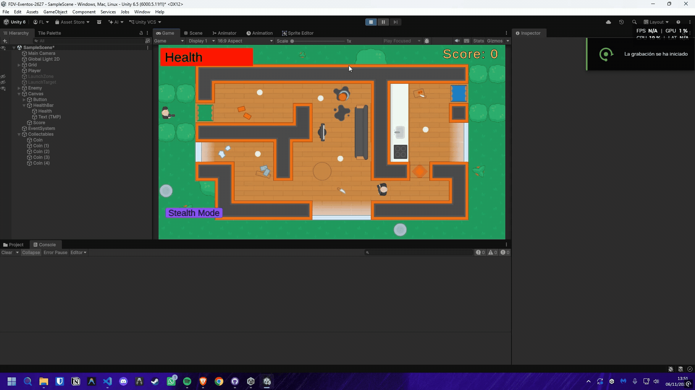
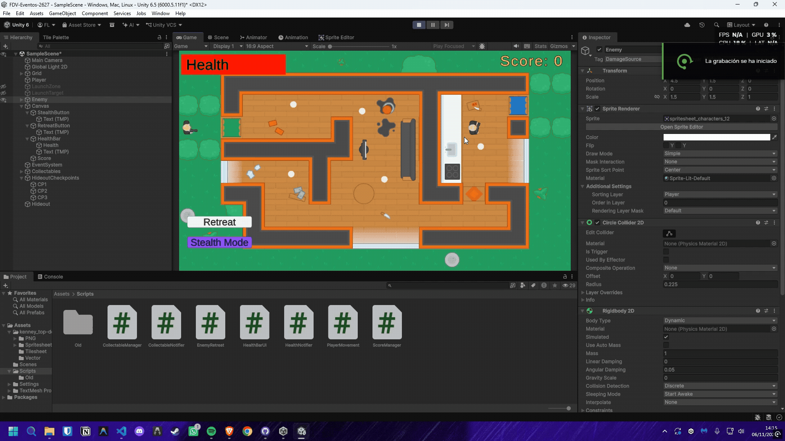
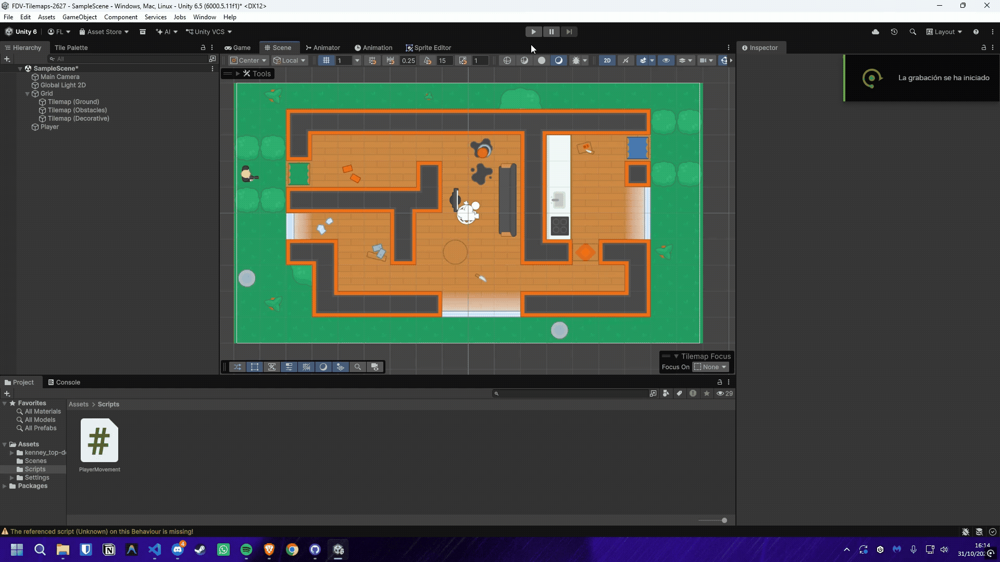

# FDV-Eventos-2627

## Ejercicio 1

1. Implementar una interfaz de usuario (UI) en Unity 2D que cumpla con los siguientes requisitos: Incluye un botón o selector que permite alternar el modo de movimiento del personaje entre Modo Sigilo (velocidad reducida) y Modo Normal (velocidad estándar). Muestra en pantalla la cantidad de objetos recolectados (ej. monedas o cristales). Si el personaje choca contra un objeto especial o trampa 2D, se debe descontar automáticamente un valor de su barra/texto de resistencia o vida en la UI.

***Basandonos en el progreso conseguido durante la entrega anterior, modificaremos el proyecto para incluir el botón de "Stealth Mode", este tendrá un evento OnClick que activará el modo sigilo en el script de movimiento del personaje, para el cual, tendremos que modificar el código original de movimiento, para que pueda recibir un parámetro que indique si el personaje está en modo sigilo o no, y en base a esto, modificar la velocidad de movimiento del personaje.***

***Para esto, se incluyó un nuevo método público en el script de movimiento del personaje llamado "SwitchStealthMode()", el cual alternará el estado del modo sigilo y ajustará la velocidad de movimiento en consecuencia en el "FixedUpdate()". Además, se agregó un mensaje de depuración para indicar si el modo sigilo está activado o desactivado. Posterior a ello, se conectó el método al evento "OnClick" del botón.***

```csharp
public class PlayerMovement : MonoBehaviour
{
    private bool isStealthMode = false;

    private void FixedUpdate()
    {
        if (launchTimeRemaining > 0f)
        {
            rb.linearVelocity = launchVelocity;
            launchTimeRemaining -= Time.fixedDeltaTime;
            return;
        }

        if (isStealthMode) rb.linearVelocity = movement * (speed * 0.5f);
        else               rb.linearVelocity = movement * speed;

        if (movement.sqrMagnitude == 0f) return;

        float targetAngle = Mathf.Atan2(movement.y, movement.x) * Mathf.Rad2Deg;
        float nextAngle = Mathf.MoveTowardsAngle(
            rb.rotation,
            targetAngle,
            rotationSpeed * Time.fixedDeltaTime);
        rb.MoveRotation(nextAngle);
    }

    public void SwitchStealthMode()
    {
        isStealthMode = !isStealthMode;
        Debug.Log("Stealth Mode: " + (isStealthMode ? "ON" : "OFF"));
    }
}
```

***Para los objetos recolectables, se creó un script llamado "CollectableNotifier" que contiene un evento "OnCollected" y el evento "OnScoreChanged" que se dispara cuando el personaje colisiona con un objeto recolectable. Este último evento se conecta al script "ScoreManager" para actualizar la puntuación en la UI.***

```csharp
public class CollectableNotifier : MonoBehaviour
{
    public UnityEvent<string> OnCollected;
    public UnityEvent OnScoreChanged;

    void OnTriggerEnter2D(Collider2D other)
    {
        if (other.CompareTag("Collectable"))
        {
            OnCollected?.Invoke(other.name);
            OnScoreChanged?.Invoke();
        }
    }
}
```

```csharp
public class CollectableManager : MonoBehaviour
{
    [SerializeField]
    private CollectableNotifier collectableNotifier;

    void Start()
    {
        collectableNotifier.OnCollected.AddListener(OnCollected);
    }

    public void OnCollected(string collectableName)
    {
        if (collectableName == gameObject.name)
        {
            Destroy(gameObject);
        }
    }
}
```

```csharp
public class ScoreManager : MonoBehaviour
{
    [SerializeField] 
    private CollectableNotifier collectableNotifier;
    Text scoreText;
    float score = 0f;

    void Start()
    {
        scoreText = GetComponent<TMP_Text>();
        scoreText.text = "Score: " + score.ToString("F0");

        collectableNotifier.OnScoreChanged.AddListener(ChangeScore);
    }

    public void ChangeScore()
    {
        score += 1f;
        scoreText.text = "Score: " + score.ToString("F0");
    }
}
```

***Finalmente para la barra de resistencia o vida, se creó un script llamado "HealthNotifier" que contiene un evento "OnHealthChanged" que se dispara cuando el personaje colisiona con un objeto especial o trampa 2D (DamageSource). Este evento se conecta al script "HealthBarUI" para actualizar la barra de vida en la UI.***

```csharp
public class HealthNotifier : MonoBehaviour
{
    public UnityEvent<float> OnHealthChanged;
    public float timer = 0f;

    void Update()
    {
        if (timer < 1f) timer += Time.deltaTime;
    }

    void OnCollisionStay2D(Collision2D collision)
    {
        if (collision.gameObject.CompareTag("DamageSource") && timer >= 1f)
        {
            float damage = 10f; // Example damage value
            OnHealthChanged?.Invoke(damage);
            timer = 0f;
        }
    }
}
```

***El notifier funciona de tal manera que mientras el personaje esté en contacto con un objeto de daño, se descontará automáticamente un valor de su barra de vida cada segundo. Esto se logra mediante un temporizador que se reinicia cada vez que se aplica daño, asegurando que el daño no se aplique más de una vez por segundo.***

```csharp
public class HealthBarUI : MonoBehaviour
{
    [SerializeField]
    private HealthNotifier healthNotifier;
    private float health, maxHealth;
    private float width = 256f;
    private float height = 50f;

    [SerializeField] 
    private RectTransform healthBar;

    void Start()
    {
        maxHealth = 100f;
        health = maxHealth;
        healthBar.pivot = new Vector2(0f, 0.5f);
        healthBar.sizeDelta = new Vector2(width, height);

        healthNotifier.OnHealthChanged.AddListener(SetHealth);
    }

    public void SetHealth(float phealth)
    {
        health = Mathf.Clamp(health - phealth, 0f, maxHealth);
        float newWidth = (health / maxHealth) * width;

        healthBar.sizeDelta = new Vector2(newWidth, height);
    }
}
```

***La barra de vida se actualiza en tiempo real en la UI, reflejando la cantidad de vida restante del personaje. La barra se ajusta proporcionalmente al daño recibido, proporcionando una representación visual clara del estado de salud del personaje.***

***Todo junto funcionaría tal y como se ve en el gif de ejemplo:***



## Ejercicio 2

2. Agregar un personaje a la escena que, al hacer clic sobre un botón específico de la UI, se dirija progresivamente en el espacio 2D hacia su guarida que estará posicionada en la escena.

***Para este ejercicio, se creó un script llamado "EnemyRetreat" asignado al enemigo ya existente en la escena. Este script contiene un método público llamado "Retreat()", el cual se conecta al evento "OnClick" del botón en la UI. Cuando se hace clic en el botón, el enemigo se moverá hacia su guarida a una velocidad constante.***

***El movimiento del enemigo viene definido por una serie de checkpoints que se encuentran en la escena, los cuales guían al enemigo hacia su guarida. El script utiliza un sistema de navegación simple basado en la posición de estos checkpoints para mover al enemigo de manera progresiva, pasando por cada uno de ellos hasta llegar a su destino.***

```csharp
public class EnemyRetreat : MonoBehaviour
{
    private Rigidbody2D rb;
    private bool isRetreating = false;
    private Transform[] checkpoints;
    [SerializeField]
    private Transform hideoutPoint;
    [SerializeField]
    private GameObject checkpointContainer; 
    [SerializeField]
    private float retreatSpeed = 3f;
    [SerializeField]
    private float rotationSpeed = 360f;

    void Awake()
    {
        rb = GetComponent<Rigidbody2D>();

        int checkpointCount = checkpointContainer.transform.childCount;
        checkpoints = new Transform[checkpointCount];

        for (int i = 0; i < checkpointCount; i++)
        {
            Transform checkpoint = checkpointContainer.transform.GetChild(i);
            if (checkpoint != null)
            {
                checkpoints[i] = checkpoint;
            }
        }
    }

    private void FixedUpdate()
    {
        if (!isRetreating) return;

        Transform targetPosition = hideoutPoint;
        if (checkpoints.Length > 0)
        {
            targetPosition = checkpoints[0];
        }
        Vector2 direction = (targetPosition.position - transform.position).normalized;

        Rotate(direction);
        rb.MovePosition(rb.position + direction * retreatSpeed * Time.fixedDeltaTime);

        ManageCheckpoints(targetPosition);
    }

    private void Rotate(Vector2 direction)
    {
        if (direction.sqrMagnitude == 0f) return;

        float targetAngle = Mathf.Atan2(direction.y, direction.x) * Mathf.Rad2Deg;
        float nextAngle = Mathf.MoveTowardsAngle(
            rb.rotation,
            targetAngle,
            rotationSpeed * Time.fixedDeltaTime);
        rb.MoveRotation(nextAngle);
    }

    private void ManageCheckpoints(Transform targetPosition)
    {
        if (Vector2.Distance(transform.position, targetPosition.position) < 0.1f)
        {
            if (checkpoints.Length > 0)
            {
                Transform[] newCheckpoints = new Transform[checkpoints.Length - 1];
                for (int i = 1; i < checkpoints.Length; i++)
                {
                    newCheckpoints[i - 1] = checkpoints[i];
                }
                checkpoints = newCheckpoints;
            }
            else
            {
                isRetreating = false;
                rb.linearVelocity = Vector2.zero;
            }
        }
    }

    public void Retreat()
    {
        isRetreating = true;
    }
}
```



## Ejercicio 3

3. Agregar a la escena un objeto recolectable que, al colisionar con el jugador, dispare un evento que haga que otros dos objetos en la escena realicen las siguientes acciones simultáneamente:

- Objeto A: Comienza a desplazarse de forma fluida hacia la posición actual del jugador.

- Objeto B: Se posiciona o traslada de forma inmediata a un punto fijo determinado dentro de la escena.

***Para este ejercicio, se creó un script llamado "KnifeNotifier" que contiene un evento "OnKnifeCollected". Este evento se dispara cuando el jugador colisiona con el objeto recolectable (cuchillo). El evento está conectado a los scripts de los objetos A y B para que realicen sus respectivas acciones simultáneamente. El objeto A se trata de un NPC que sigue al jugador, mientras que el objeto B se trata de otro NPC que se teletransporta a la guarida del enemigo.***

```csharp
public class KnifeNotifier : MonoBehaviour
{
    public UnityEvent OnKnifeCollected;

    void OnTriggerEnter2D(Collider2D other)
    {
        if (other.CompareTag("Player"))
        {
            OnKnifeCollected?.Invoke();
            Destroy(gameObject);
        }
    }
}
```

```csharp
public class NPCFollow : MonoBehaviour
{
    [SerializeField]
    private KnifeNotifier notifier;
    [SerializeField]
    private Transform playerTransform;
    [SerializeField]
    private float speed = 2f;
    [SerializeField]
    private float rotationSpeed = 360f;
    private Rigidbody2D rb;
    private bool isFollowing = false;

    void Awake()
    {
        rb = GetComponent<Rigidbody2D>();
        notifier.OnKnifeCollected.AddListener(FollowPlayer);
    }

    void FixedUpdate()
    {
        if (!isFollowing) return;

        Vector2 direction = ((Vector2)playerTransform.position - rb.position).normalized;
        rb.MovePosition(rb.position + direction * speed * Time.fixedDeltaTime);

        if (direction.sqrMagnitude == 0f) return;

        float targetAngle = Mathf.Atan2(direction.y, direction.x) * Mathf.Rad2Deg;
        float nextAngle = Mathf.MoveTowardsAngle(
            rb.rotation,
            targetAngle,
            rotationSpeed * Time.fixedDeltaTime);
        rb.MoveRotation(nextAngle);
    }

    private void FollowPlayer()
    {
        isFollowing = true;
    }
}
```

```csharp
public class NPCTeleport : MonoBehaviour
{
    [SerializeField]
    private Transform teleportTarget;
    [SerializeField]
    private KnifeNotifier notifier;
    void Start()
    {
        notifier.OnKnifeCollected.AddListener(Teleport);
    }

    void Teleport()
    {
        transform.position = teleportTarget.position;
    }
}
```

